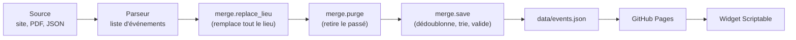

# Documentation technique

Ce document décrit le fonctionnement interne du dépôt. Pour le but du projet et l'installation, voir le [README](../README.md).

## Architecture

```
culture-widget/
├── data/
│   ├── events.json               # LE fichier lu par le widget (publié par GitHub Pages)
│   └── philharmonie-cache.json   # cache des fiches de la Philharmonie
├── widget/EventsWidget.js        # script Scriptable (iPhone)
├── pdf/                          # PDF hebdomadaires de La Scala, déposés à la main
├── jpg/                          # ou la même grille publiée en image (JPG)
├── json/                         # programmes de saison saisis à la main (Théâtre, Adagio)
├── scripts/
│   ├── common.py                 # fuseau, normalisation de texte, identifiants, mois
│   ├── merge.py                  # chargement, remplacement par lieu, purge, validation, écriture
│   ├── scrape_sources.py         # orchestrateur des sources automatiques
│   ├── sources/                  # un parseur par lieu « scrapable » depuis GitHub Actions
│   │   ├── arsenal.py
│   │   ├── philharmonie.py
│   │   └── nest.py
│   ├── scrape_kinepolis.py       # Kinepolis : navigateur piloté, à lancer en local
│   ├── extract_pdf.py            # import des PDF de La Scala
│   ├── extract_jpg.py            # lecture des grilles en image (OCR Tesseract)
│   ├── import_json.py            # import des json/*.json
│   └── tests/test_scripts.py     # tests sans réseau
├── .github/workflows/
│   ├── refresh-scrape.yml        # sources automatiques + purge, chaque lundi
│   └── import-pdf.yml            # import PDF / JSON à chaque dépôt de fichier
├── requirements.txt              # dépendances des workflows
└── requirements-kinepolis.txt    # + Playwright, pour le script Kinepolis
```

Tous les chemins d'écriture passent par `merge.py`. Chaque producteur de données (parseur, import PDF, import JSON, script Kinepolis) suit le même schéma :



Principes :

- **Une source = un lieu.** Une source remplace tous les événements de son lieu (`replace_lieu`). Elle ne touche donc jamais aux autres lieux, et la relancer ne crée pas de doublons.
- **Jamais de fichier cassé publié.** `merge.save` valide le document (champs obligatoires, catégories connues, dates avec fuseau, ids uniques, `fin` ≥ `debut`) avant d'écrire.
- **Une source en panne ne bloque pas les autres.** L'orchestrateur isole chaque source : en cas d'échec, ses anciennes données sont conservées, la purge a quand même lieu, et le workflow finit en échec (e-mail de GitHub).

## Format de `data/events.json`

```json
{
  "updated_at": "2026-10-04T18:00:00+02:00",
  "events": [
    {
      "id": "la-scala-2026-10-07-2020-her-private-hell",
      "lieu": "La Scala",
      "ville": "Thionville",
      "categorie": "cinema",
      "titre": "Her Private Hell",
      "debut": "2026-10-07T20:20:00+02:00",
      "duree_min": 110,
      "version": "VOST",
      "note": "texte libre facultatif",
      "url": "https://www.thionville.fr/scala/programmation-cinema"
    }
  ]
}
```

| Champ | Obligatoire | Description |
|---|---|---|
| `id` | oui | `<lieu>-<AAAA-MM-JJ-HHMM>-<titre>` en minuscules sans accents (`common.make_id`) |
| `lieu`, `ville`, `titre` | oui | texte libre ; le widget filtre sur `lieu`, `ville` et `categorie` |
| `categorie` | oui | `cinema`, `concert`, `spectacle`, `expo` ou `festival` |
| `debut` | oui | ISO 8601 avec fuseau (`+02:00` l'été, `+01:00` l'hiver) |
| `fin`, `jour_entier` | non | événement sans heure ou sur plusieurs jours : `jour_entier: true`, `debut` à minuit, `fin` à 23:59:59 du dernier jour |
| `duree_min`, `version` | non | cinéma : durée en minutes, `VF`, `VOST`, `VO`... |
| `note` | non | texte affiché sous le titre (salle, genre, mentions) |
| `url` | non | page ouverte au tap sur l'événement |

**Purge** : un événement est supprimé quand sa fin (ou son début s'il n'a pas de fin) est antérieure au début de la journée en cours, heure de Paris. La purge a lieu à chaque écriture du fichier : passage hebdomadaire des sources automatiques, import d'un PDF ou d'un JSON, script Kinepolis. Entre deux passages, le fichier peut contenir des événements passés, mais le widget les masque de lui-même. Une exposition reste jusqu'à son dernier jour.

## Le widget

`widget/EventsWidget.js` télécharge `events.json`, le garde en cache local pour le mode hors ligne, et affiche :

- **dans le widget** : les événements à venir, regroupés par jour. Un film est regroupé sur une ligne avec toutes ses heures de la journée. Une séance reste visible 10 minutes après son début, un événement « jour entier » jusqu'à sa fin ;
- **au tap** (ou au bouton lecture) : une liste complète avec filtres lieu / genre, période et recherche.

**Liste à swipe.** La liste est une page HTML affichée dans une `WebView` : le tableau natif de Scriptable (`UITable`) ne gère pas les swipes.

- Le script construit la page (`listHtml`) avec les événements à venir, y compris les masqués, et les choix de l'utilisateur. Le filtrage, le regroupement et les gestes se font ensuite dans la page.
- Les données sont injectées avec `<` échappé, et tout le texte passe par `textContent`. Un titre récupéré sur un site ne peut donc pas injecter de HTML.
- Swipe à gauche au-delà de 80 px : masquer. Swipe à droite : basculer le favori. Un toast propose « Annuler » pendant 4 s. Dans la vue « Masqués », un swipe dans un sens ou dans l'autre réaffiche le film.
- La page envoie ses messages (`hide`, `unhide`, `fav`, `unfav`, `open`) en naviguant vers `widget://msg?d=<json>` (espacés de 80 ms). Le script les intercepte dans `shouldAllowRequest`, annule la navigation et enregistre chaque choix aussitôt. `open` ouvre la page de l'événement dans Safari. (Ne pas utiliser `evaluateJavaScript(..., true)` en attente d'un geste : il bloque l'affichage de la WebView.)
- Les choix sont stockés dans `events-prefs.json`, dans les documents locaux de Scriptable : `{ "hidden": {clé: true}, "favorites": {clé: true} }`. La clé vaut `lieu|titre` normalisés (`eventKey`), donc un choix couvre toutes les séances d'un film dans un lieu. Ce fichier n'est pas touché par la mise à jour automatique du script.
- Le widget lit les mêmes choix : il écarte les films masqués, préfixe les favoris d'une ★, et le terme de filtre `favoris` ne garde que ceux-ci.

**Filtre** (paramètre du widget) : liste séparée par des virgules, en ignorant les majuscules et les accents. Un événement est retenu si un des termes est égal à sa `ville` ou à sa `categorie`, ou s'il correspond au nom de son `lieu`, complet ou en mots entiers : `Philharmonie` trouve « Philharmonie Luxembourg », mais `Phil` ne trouve rien.

Aperçu d'une taille précise depuis l'app : ajouter `?apercu=small|medium|large` à l'URL de lancement.

**Mise à jour automatique** (`selfUpdate`, en fin d'exécution) :

- Au plus une fois toutes les 24 h, le script télécharge `widget/EventsWidget.js` depuis GitHub Pages (`SCRIPT_URL`).
- Si la version reçue diffère de la sienne, il réécrit son propre fichier (`module.filename`, dans iCloud Drive/Scriptable ou en local), et la nouvelle version s'applique au lancement suivant.
- Rien n'est écrit si la réponse n'est pas un HTTP 200 ou si le fichier reçu ne contient pas le titre du widget et `Script.complete()`. Les erreurs sont ignorées : nouvel essai au lancement suivant.
- Comptez jusqu'à environ 10 minutes après un push (cache de GitHub Pages), plus le délai de 24 h. Pour forcer une vérification, supprimer `events-widget-update.txt` dans les documents locaux de Scriptable.
- Conséquence : le téléphone exécute ce qui est publié sur `main`. Seul le propriétaire du dépôt peut y pousser, et une règle (« Protéger main ») y interdit les force-push et la suppression de la branche.

## Sources

### Mises à jour automatiques (`refresh-scrape.yml`)

Le workflow tourne une fois par semaine, le lundi vers 5 h (heure de Paris), et peut être lancé à la main (**Actions > Rafraîchir les événements > Run workflow**). Il exécute `scripts/scrape_sources.py`, qui appelle chaque source de la liste `SOURCES`, purge, valide, puis commite `data/events.json` et `data/philharmonie-cache.json` s'ils ont changé. Toutes les sources respectent le `robots.txt` des sites et font au plus une requête par seconde.

#### L'Arsenal (Metz) - `sources/arsenal.py`

- **Source :** la page de programmation de la Cité musicale-Metz filtrée sur l'Arsenal, paginée (`?page=2`, `3`...).
- **Parseur :** il ne dépend d'aucune classe CSS. Il repère les liens vers les fiches, remonte jusqu'à la « carte » qui les contient, puis classe chaque ligne de texte (titre, catégorie, dates, lieu, badges).
- **Dates :** il comprend « 6 oct. 2026, 20h » et les périodes « 21 oct. → 22 oct. 2026 », y compris à cheval sur le nouvel an.
- **Lieux écartés :** la BAM, les Trinitaires et le « Hors les murs ». Pour les inclure, il faut modifier `OTHER_VENUES`.

#### Philharmonie Luxembourg - `sources/philharmonie.py`

- **Source :** le `robots.txt` interdit les pages de liste (`/fr/programme?page=N`). Le parseur lit donc le sitemap `fr-lu.xml`, garde les fiches directes des saisons en cours ou à venir (`/fr/programme/2026-27/<slug>-<id>`), puis ouvre chaque fiche.
- **Lecture d'une fiche :**
  - titre, date et heure dans `og:title` (« Mozart Requiem | 06.03.2027 19:30 ») ;
  - salle dans le bloc « Détails » ;
  - jeune public repéré par `data-is-kids="True"` sur le `<h1>`. Ces événements sont écartés.
- **Cache :** `data/philharmonie-cache.json` associe à chaque fiche sa date `lastmod` du sitemap et le résultat de sa lecture. Une fiche n'est relue que si elle est nouvelle ou modifiée. Il faut environ 7 minutes sans cache, quelques secondes avec. Supprimer le fichier force une relecture complète.
- **Garde-fous :**
  - au plus 500 fiches lues par passage ;
  - échec si plus de 20 % des fiches sont illisibles ;
  - une fiche en erreur garde sa lecture précédente.

#### NEST (Thionville) - `sources/nest.py`

- **Source :**
  - l'accueil, pour trouver le lien de saison (`/saison/26-27`). La saison suivante est donc prise en compte dès sa publication ;
  - la page de saison, pour la liste des spectacles et leurs genres ;
  - la fiche de chaque spectacle, dont le bloc « Séances » donne chaque représentation : `<strong>lieu</strong><span>mardi 4 mai à 20h</span>`.
- **Année :** elle est absente des séances et déduite de la saison (août à décembre → première année, janvier à juillet → seconde).
- **« à 00h » :** une séance avec un lieu devient « jour entier ». Sans lieu, c'est une borne de tournée (lycées), qui est ignorée.
- **Ville :**
  - celle qui suit la virgule du lieu (« Espace Riom, Boulange » → Boulange) ;
  - sinon « Thionville » si le lieu la nomme ;
  - sinon « Environs de Thionville ».
- **Lieu inconnu :** le lieu « En attente » est noté « Lieu à confirmer ».
- **Catégorie :** `concert` si un genre contient « concert » ou « musique », `festival` pour « festival », sinon `spectacle`.

### Kinepolis Thionville - `scripts/scrape_kinepolis.py` (en local)

- **Pourquoi en local :** le site renvoie une page 403 « Suspicious Activity Detected » aux requêtes simples comme à un Chromium sans fenêtre. Le script pilote donc une **fenêtre Chromium visible** avec Playwright, et ne peut pas tourner dans GitHub Actions.
- **Déroulé :**
  1. il ouvre `https://kinepolis.fr/?complex=KTHIO&main_section=aujourd'hui` et accepte les cookies ;
  2. il lit les dates proposées dans le sélecteur `.date-filter > div:nth-child(1) > div:nth-child(2)`, qui contient un `<select id="dates_filter">` habillé par SumoSelect ;
  3. pour chaque date, il clique le sélecteur puis l'option, et lit les films et séances **visibles** (le filtrage se fait dans la page, sans requête réseau) : titre, version, salle, heures ;
  4. il récupère la durée de chaque film dans les données embarquées par la page (`Drupal.settings.variables.current_movies.films`, indexées par `corporateId`).
- **Versions normalisées :**

  | Libellé du site | Version |
  |---|---|
  | « Version Française » | `VF` |
  | « Version Allemande (Sous-tîtres : Français) » | `VOST` |
  | « (Sous-titres - Anglais) » | `VO ST anglais` |
  | « Version Originale » | `VO` |

```
python scripts/scrape_kinepolis.py                    # met à jour data/events.json
python scripts/scrape_kinepolis.py --dry-run          # affiche sans écrire
python scripts/scrape_kinepolis.py --max-dates 3      # limite le nombre de dates
python scripts/scrape_kinepolis.py --headless         # sans fenêtre (bloqué à ce jour)
```

À noter : `Drupal.settings` contient en fait toutes les séances de tous les cinémas Kinepolis (`current_movies.sessions`, filtrables sur `complexOperator == "KTHIO"`). C'est une piste plus simple si le parcours du sélecteur venait à casser.

### La Scala - `scripts/extract_pdf.py` (`import-pdf.yml`)

- **Déclenchement :** chaque semaine, La Scala publie une grille horaire en PDF ou, depuis fin octobre 2026, en JPG. Le workflow se lance à chaque fichier ajouté dans `pdf/`, `jpg/` ou `json/`, ou à la main.
- **Lecture :** `extract_pdf.py` lit la grille avec `pdfplumber`, puis :
  - remplace les séances de La Scala de la semaine du PDF ;
  - ajoute les « Événements à venir » du bas de page (ciné-débats, avant-premières...). Plusieurs films pour une seule date (double programme) reçoivent tous cette date.
- **Grille en image :** `extract_jpg.py` retrouve la même géométrie à partir des pixels rouges (filets, bandeaux, séparateurs de colonnes), puis lit chaque case avec Tesseract (`tesseract-ocr-fra`, installé par le workflow). Les titres sont repérés au gras (épaisseur des traits). Les horaires sont lus colonne par colonne, limités aux chiffres et au « h ». Une image prend une quinzaine de secondes.
- **Ce qui est repris :** titre, horaires par jour, durée et version. Les mentions des bandeaux (« Dernière semaine », « Jeune public », ciné-club, festival...) vont dans la note.
- **Anciens PDF :** ils restent sans effet, puisque leurs séances sont passées et donc purgées.
- **En cas d'échec :** si la mise en page n'est plus reconnue, le workflow échoue et `events.json` n'est pas modifié.

### Programmes de saison - `scripts/import_json.py` (`import-pdf.yml`)

Les programmes qui n'ont ni site lisible ni PDF régulier (Théâtre de Thionville, Adagio) sont saisis dans `json/*.json` au format `{"source": "<url>", "events": [...]}`, avec des événements au format ci-dessus. Adaptations à l'import :

- les genres `theatre`, `danse`, `humour` et `conference` deviennent `spectacle`, et le genre passe dans la note ;
- `artiste` est ajouté à la note ;
- sans `url`, l'événement pointe vers la `source` du fichier ;
- chaque fichier remplace ce qu'il avait importé la fois précédente (champ `import`) : on peut le corriger et le recommiter sans doublons.

## Ajouter un lieu

1. **Site lisible depuis un serveur :** créer `scripts/sources/<nom>.py` avec une constante `LIEU` et une fonction `fetch_events() -> list[dict]`, puis l'ajouter à `SOURCES` dans `scripts/scrape_sources.py`. S'inspirer de `nest.py` (liste + fiches) ou de `arsenal.py` (liste paginée). Respecter `robots.txt`, faire une requête par seconde au plus, et lever une exception si rien n'est trouvé pour que les anciennes données soient conservées.
2. **Site qui bloque les robots :** un script local sur le modèle de `scrape_kinepolis.py`.
3. **Programme en PDF ou papier :** un fichier `json/<nom>.json`.

Dans tous les cas, ajouter des tests sans réseau sur des extraits HTML.

## Tests et commandes utiles

Python 3.11 ou plus récent.

```
pip install -r requirements.txt
python -m unittest discover -s scripts/tests -v       # tests sans réseau
python scripts/merge.py                                # purge + validation seules
python scripts/scrape_sources.py                       # sources automatiques + purge
python scripts/extract_pdf.py --dry-run pdf/x.pdf      # test d'un PDF de La Scala
python scripts/extract_pdf.py --dry-run jpg/x.jpg      # idem pour une grille en image (Tesseract + langue fra requis)
python scripts/import_json.py --dry-run json/x.json    # test d'un programme de saison
```

Les tests de La Scala utilisent un PDF d'exemple et sont ignorés s'il est absent.

## Pistes

- Scraping automatique de La Scala : le PDF reste le moyen fiable pour l'instant.
- Lignes cliquables dans le widget pour déclencher une Action GitHub (token fine-grained dans le Keychain).
- Kinepolis : passer à la lecture de `Drupal.settings` si le parcours du sélecteur casse.
